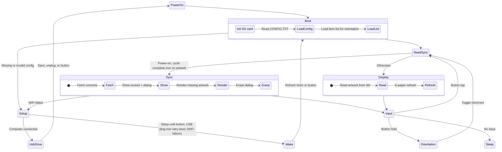
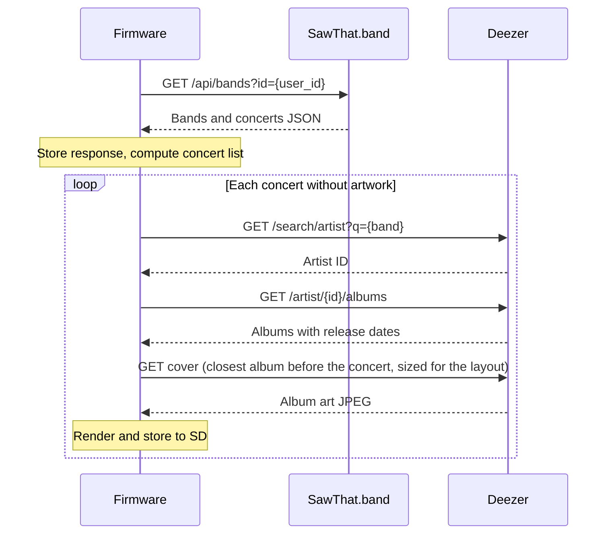

# SawThat Frame

E-paper display frame for concert/album art data pulled from [sawthat.band](https://sawthat.band).

Built on the [Waveshare ESP32-S3-PhotoPainter](https://www.amazon.com/dp/B0FWRJD8HZ):
- 7.3" Spectra 6 color e-paper display
- ESP32-S3 with wifi and ble
- SDMMC reader with included 16GB sdcard
- GPIO Buttons and LEDs
- (unused) Speaker, microphones

Everything runs on the device: it fetches concerts from SawThat, finds matching album art
on Deezer, renders it for the 6-color display, and caches the result on the SD card.

## Examples

### Physical Device


### Rendered Artwork


## Usage

Installation:

1. Prepare a FAT32 SD card with a `CONFIG.TXT` in its root (see [Configuration](#configuration))
2. Insert the SD card into the frame
3. Flash the firmware (see [Build and flash](#build-and-flash)) and wait for the first sync
   to finish on the device

Step 1 can also be done on the device: with a blank FAT32 card, the frame writes a
`CONFIG.TXT` template and appears as a USB drive to fill it in (see [USB drive
mode](#usb-drive-mode)).

### Requirements

- Rustup
- Espup
- Espflash

A nix dev shell can be used for all required build tools:

```bash
nix develop
```

Install the ESP Rust toolchain using [espup](https://github.com/esp-rs/espup):

```bash
espup install
source ~/export-esp.sh
```

### Configuration

The frame reads `CONFIG.TXT` from the SD card root at every boot, so nothing is configured at
build time. Copy [`docs/CONFIG.TXT`](docs/CONFIG.TXT) to the card and fill it in:

```ini
WIFI_SSID=your-ssid
WIFI_PASS=your-password
SAWTHAT_USER_ID=your-sawthat-user-id
```

| Key | Required | Default | Purpose |
|-----|----------|---------|---------|
| `WIFI_SSID` | yes | | WiFi network name |
| `WIFI_PASS` | no | open network | WiFi password (8-64 characters) |
| `SAWTHAT_USER_ID` | yes | | SawThat user whose concerts are shown |
| `REFRESH_MINUTES` | no | 15 | Minutes between artwork changes (1-1440) |
| `ORIENTATION` | no | horizontal | `horizontal` or `vertical`; holding KEY rewrites this line |

Lines are `KEY=VALUE`; blank lines and lines starting with `#` are ignored.

To use a custom font for the concert text instead of IBM Plex Mono Bold, put `FONT.TTF` or
`FONT.OTF` in the SD card root. An invalid font falls back to the built-in one. Adding,
replacing or removing the font renders all artwork again on the next sync.

If the card or `CONFIG.TXT` is missing, or a value is invalid, the frame shows a setup screen
describing the problem. A missing `CONFIG.TXT` is replaced with the template. The next boot
after the config is fixed syncs like a power-on.

A sync that cannot connect to WiFi also shows the setup screen, replacing any artwork, with
the cause as the problem: network not found, wrong password, no IP address, or the ESP-IDF
reason code. A missing network or rejected password fails after two attempts (about 10
seconds); other failures retry for up to 60 seconds. The frame retries every
`REFRESH_MINUTES`, so it recovers by itself once the network is back.

### USB drive mode

On the setup screen, if the frame is connected to a computer, the whole SD card appears as a
USB drive, including the artwork cache. Edit `CONFIG.TXT` (or add a font), then eject the
drive; the frame restarts and reads the new config. Pressing KEY or BOOT, or unplugging, also
restarts it, but eject first so the computer finishes writing.

At any other time, pressing BOOT while connected to a computer enters drive mode too, with a
"USB Drive Mode" box over the current screen. BOOT wakes the frame from sleep; a press while
it is refreshing or syncing takes effect when that finishes. Without a computer connected,
BOOT does nothing.

Without a computer connected, the setup screen sleeps until KEY or BOOT is pressed or USB is
plugged in (or the retry timer, for a WiFi failure).

The drive uses the same USB port as the serial console, so the console disconnects while the
drive is shown. Flashing works again after the frame restarts, or by holding BOOT while
pressing RESET.

### Build and flash

Flash the firmware to the device and connect to the serial console:

```bash
cd firmware
cargo run --release
```

### Button Controls

The KEY button controls navigation and orientation:

| Action | Duration | Effect |
|--------|----------|--------|
| Tap | < 500ms | Next item |
| Hold | >= 500ms | Toggle orientation (horizontal/vertical), saved as `ORIENTATION` in `CONFIG.TXT` |

Button input is detected in three places:
- **On wake**: Immediately after waking from deep sleep
- **During refresh**: While the e-paper display is refreshing
- **During sync**: A tap shows the next screen behind the progress dialog (waiting for its
  artwork to render if needed); a hold stops the sync and rotates

The BOOT button enters or leaves [USB drive mode](#usb-drive-mode) when the frame is connected
to a computer. Do not hold it while the frame resets or powers on: that starts the ESP32
download mode instead of the firmware.

LED feedback:
- **Green LED**: 1 flash = next item or BOOT press, 3 flashes = orientation changed
- **Red LED**: Solid = idle, blinking = syncing, fast blink = WiFi connecting

### Battery Indicator

The battery level is derived from the measured cell voltage (the PMIC's fuel gauge is
unreliable until it has seen a full charge cycle):

| Level | Fill |
|-------|------|
| 0-15% | Red |
| 16-32% | Dark orange, dithered like the artwork |
| 33-49% | Orange, dithered like the artwork |
| 50-100% | Green |

## Sync

Artwork is rendered on the device and stored on the SD card. Only the current orientation is
rendered; the other orientation is synced the first time it is shown.

A sync runs:
- **On power-on**
- **After every item has been shown** (once per full cycle through the shuffled list)
- **When the orientation is toggled** and no artwork exists for it yet

All other wakes read artwork from the SD card without using WiFi.

While syncing, the frame shows the next cached screen immediately, with a "Syncing N
concerts..." dialog and progress bar in the corner. Only the newly filled slice of the bar is
refreshed as concerts render, and the dialog is erased with a small refresh when done.

When there is no artwork for the current orientation (first boot, or the first switch to an
orientation), a centered welcome dialog with the progress bar and usage instructions is shown
instead. Once the first screen has been rendered it is shown behind the dialog, and the dialog
is erased when the sync finishes.

If SawThat is unreachable, the last successful response stored on the SD card is used.

### SD Card Layout

```
/CONFIG.TXT           # Runtime configuration, written by the user
/FONT.TTF             # Optional concert text font (or FONT.OTF)
/concerts/
  BANDS.JSN           # Last SawThat bands response
  HORIZ.JSN           # Items with horizontal artwork
  VERT.JSN            # Items with vertical artwork
  horiz/
    {hash}.IMG        # Horizontal artwork (400x480)
  vert/
    {hash}.IMG        # Vertical artwork (480x800)
```

Item paths are `YYYY-MM-DD-{band-id}`. Image filenames are 8-character hex hashes of the item
path and, with an SD card font, the font file's name, size and modification time (FAT 8.3
compatible), so a font change makes every image stale. Images are stored as a 4-byte header
(width, height) followed by 4-bit palette indices. Files for concerts that are no longer listed,
or rendered with another font, are removed after each sync.

## Specifications

### Firmware Lifecycle



### Network Interactions



Albums are looked up once per band per sync. If no album precedes the concert, the band's
Spotify picture from SawThat is used instead.

### Image Processing Pipeline

The `render` crate (`no_std`) transforms source images for the 6-color display:

1. **Resize**: Cover-fit with center crop (400x360 horizontal, 480x680 vertical). Deezer covers
   are requested at the covering size so only a crop is needed
2. **Tone adjustments**: Exposure (x0.8), saturation boost (x2.0), and S-curve for mid-tones
3. **Background color**: Dominant color of the bottom 10% of the adjusted image
4. **Canvas composition**: Image area with gradient blend into solid background for text
5. **Dithering**: Floyd-Steinberg error diffusion in OKLab color space to the 6-color palette
6. **Text rendering**: Concert info (band, date, venue) with adaptive font sizing

The same pipeline can be run on a host to preview output:

```bash
cd render
cargo run --release --example render -- cover.jpg "Band" 27-07-2012 "Venue" out
```

## Maintenance

- `embassy-net` is pinned to `=0.8.0` in `firmware/Cargo.toml`. `alloc_tcp_state` in
  `firmware/src/bin/main.rs` allocates the TCP socket buffers in PSRAM as zeroed memory, which
  relies on an all-zero `TcpClientState` matching `TcpClientState::new()`. Check that against the
  new version's source before upgrading.
- The main core needs more than 75KB of stack. Keep large buffers out of internal RAM (`.bss`), or
  the boot will overflow the stack guard.
