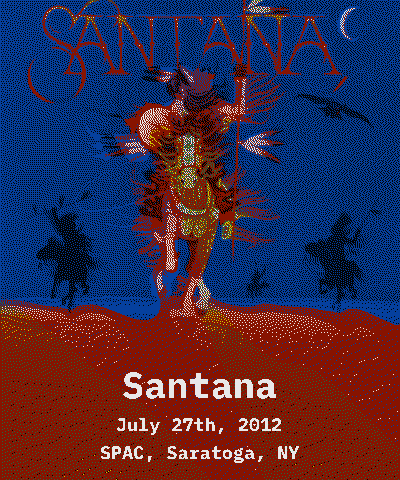
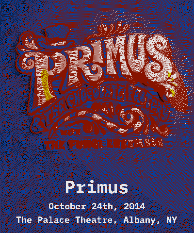
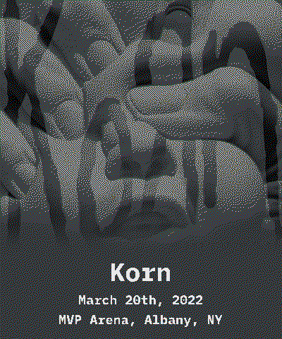
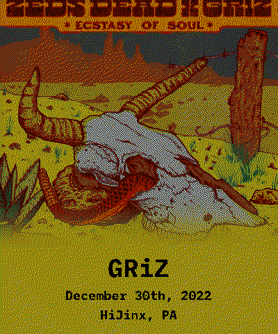
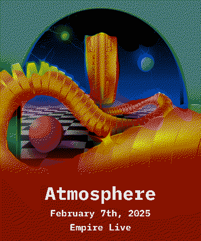
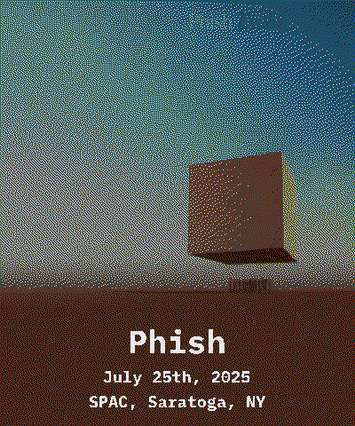
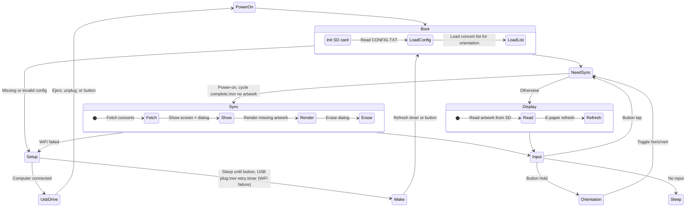
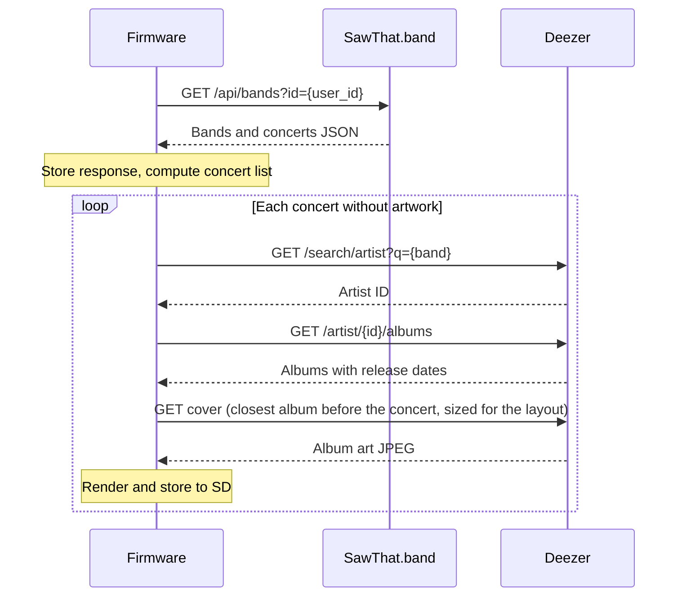

# SawThat Frame

E-paper frame showing album art for the concerts you have logged on
[sawthat.band](https://sawthat.band). It fetches concerts, finds album art on Deezer, renders it
for the 6-color display and caches it on the SD card, all on the device.

Runs on the [Waveshare ESP32-S3-PhotoPainter](https://www.waveshare.com/esp32-s3-photopainter.htm)
(7.3" Spectra 6 e-paper, ESP32-S3, SD card reader).

## Examples


<table>
  <tr>
    <td></td>
    <td></td>
    <td></td>
    <td></td>
  </tr>
  <tr>
    <td></td>
    <td></td>
    <td></td>
    <td></td>
  </tr>
</table>

## Installation

1. Insert a FAT32 SD card (cards up to 32GB usually are).
2. Flash the frame from <https://ozwaldorf.github.io/sawthat-frame/> in Chrome or Edge,
   optionally with your WiFi, SawThat user and a font.
3. Wait for the first sync.

Alternatively, fill in [`docs/CONFIG.TXT`](docs/CONFIG.TXT) on the card, or boot with a blank card
and edit the generated template over [USB](#usb-drive-mode).

## Configuration

`CONFIG.TXT` in the SD card root, read at every boot. Lines are `KEY=VALUE`; `#` starts a comment.

| Key | Default | Purpose |
|-----|---------|---------|
| `WIFI_SSID` | required | WiFi network |
| `WIFI_PASS` | open network | WiFi password |
| `SAWTHAT_USER_ID` | required | SawThat user ID, username or profile URL |
| `REFRESH_MINUTES` | 15 | Minutes between artwork changes (1-1440) |
| `ORIENTATION` | horizontal | `horizontal` or `vertical` |

Put `FONT.TTF` or `FONT.OTF` in the card root to replace the built-in font (IBM Plex Mono Bold);
changing it re-renders all artwork.

A missing or invalid config, or a failed WiFi connection, shows a setup screen with the problem.
WiFi failures retry every `REFRESH_MINUTES`.

### USB Drive Mode

Connected to a computer, the frame exposes the whole SD card as a USB drive from the setup
screen, or at any time by pressing BOOT. Eject it when done and the frame restarts with the new
config. The serial console is unavailable while the drive is shown.

## Controls

| Input | Effect |
|-------|--------|
| Tap KEY | Next item |
| Hold KEY | Toggle orientation |
| Press BOOT | Toggle USB drive mode (connected to a computer) |

Do not hold BOOT while the frame powers on: that enters ESP32 download mode.

The green LED flashes once for a press and three times for a rotation. The red LED is solid when
idle, blinks while syncing and blinks fast while connecting to WiFi.

On a crash the frame shows the panic and stack trace with a QR code for a pre-filled GitHub
issue, then turns off until KEY is pressed.

## Sync

A sync fetches concerts and renders missing artwork for the current orientation. It runs on
power-on, after every item has been shown once, and on switching to an orientation with no
artwork. Other wakes only read from the SD card. If SawThat is unreachable, the last response is
used.

```
/CONFIG.TXT           # Configuration
/FONT.TTF             # Optional font (or FONT.OTF)
/BATTERY.CSV          # Power reading per wake
/concerts/
  BANDS.JSN           # Last SawThat response
  HORIZ.JSN           # Concerts with horizontal artwork
  VERT.JSN            # Concerts with vertical artwork
  horiz/{hash}.IMG    # 400x480 artwork
  vert/{hash}.IMG     # 480x800 artwork
```

Images are a 4-byte size header followed by 4-bit palette indices, named by a hash of the
concert and font. Stale images are removed after each sync.

## Specifications

### Firmware Lifecycle



### Network Interactions



Albums are looked up once per band per sync. If no album precedes the concert, the band's
Spotify picture from SawThat is used instead.

### Image Processing Pipeline

The `render` crate (`no_std`) transforms source images for the 6-color display:

1. **Resize**: Cover-fit with center crop (400x360 horizontal, 480x680 vertical). Deezer covers
   are requested at the covering size so only a crop is needed
2. **Tone adjustments**: Exposure (x0.8), saturation boost (x2.0), and S-curve for mid-tones
3. **Background color**: Dominant color of the bottom 10% of the adjusted image
4. **Canvas composition**: Image area with gradient blend into solid background for text
5. **Dithering**: Floyd-Steinberg error diffusion in OKLab color space to the 6-color palette
6. **Text rendering**: Concert info (band, date, venue) with adaptive font sizing

The same pipeline can be run on a host to preview output:

```bash
cd crates/render
cargo run --release --example render -- cover.jpg "Band" 27-07-2012 "Venue" out
```


## Development

Requires rustup, espup and espflash (`nix develop` provides them). The toolchain is pinned, as
esp-hal 1.2.2 does not link with 1.99:

```bash
espup install -t esp32s3 -v 1.98.1.0
source ~/export-esp.sh
```

Build, flash and open the serial console:

```bash
cd crates/firmware
cargo run --release
```

The runner embeds function names (`crates/symtab`) so crash reports show a named stack trace.

Publishing a GitHub release attaches the firmware to it and deploys the web installer.

### Maintenance

- `embassy-net` is pinned exactly: `alloc_tcp_state` in `crates/firmware/src/bin/main.rs`
  assumes a zeroed `TcpClientState` equals `TcpClientState::new()`. Re-check before upgrading.
- The main core needs over 75KB of stack. Keep large buffers out of internal RAM.
